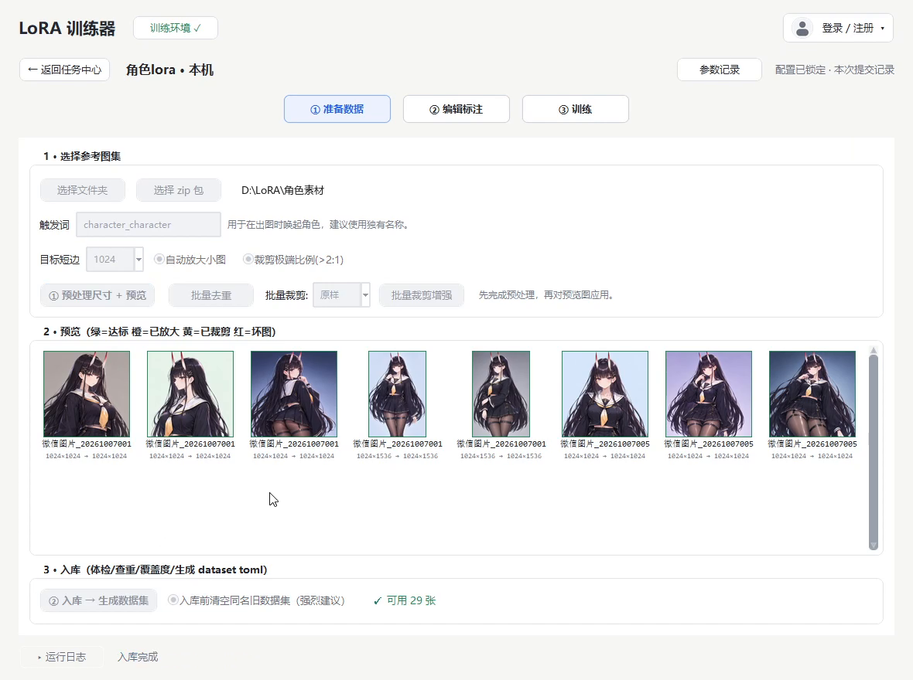
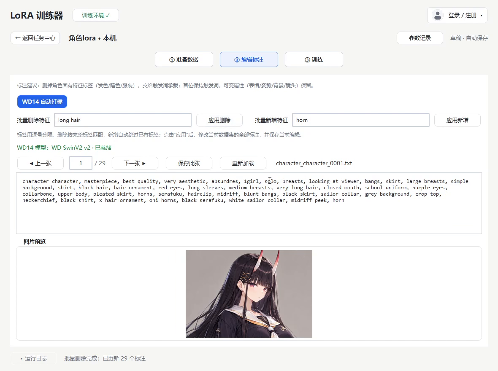
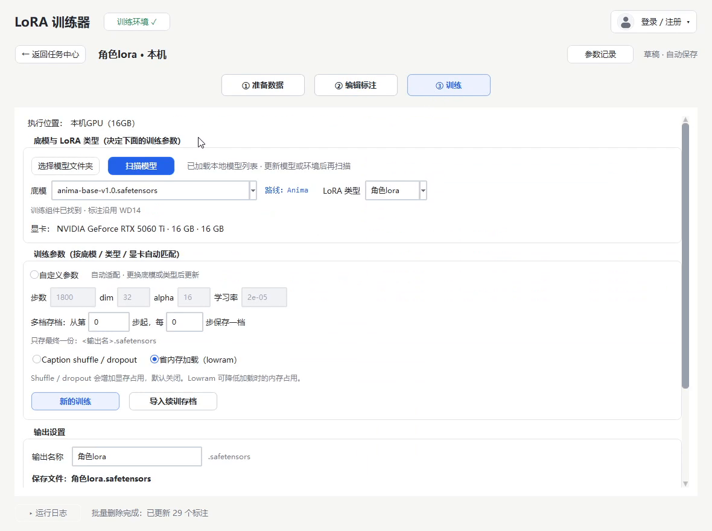
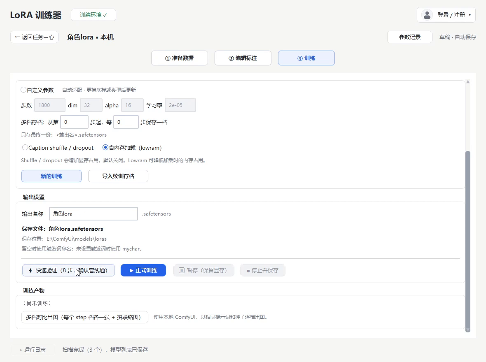

# 一键LoRA · LoRA 训练器

**从参考图到可用的 LoRA，只差几个按钮。**

面向本机的桌面 LoRA 训练工具：素材预处理、WD14 自动打标、参数自动适配、训练与多档对比出图，全程点选完成，不用记 sd-scripts 参数。

**[下载最新版](https://github.com/kongqijun/one-click-lora-trainer/releases/latest)** · **[界面与说明](https://kongqijun.github.io/one-click-lora-trainer/)** · **[更新日志](https://github.com/kongqijun/one-click-lora-trainer/releases)**

> 本仓库只存放发布产物与更新清单，不含应用源码。

## 能做什么

- **素材准备，一次到位** —— 短边自动放大、极端比例自动裁剪、批量去重与裁剪增强；预览图按状态着色（达标 / 已放大 / 已裁剪 / 坏图），哪张不达标一眼看到。
- **WD14 自动打标** —— 内置 SwinV2 打标模型，整批生成标签；支持批量增删特征、逐张校对与重新加载。
- **参数自动适配** —— 按底模、LoRA 类型和显卡档位（8G–32G）自动给出步数、dim、alpha 与学习率；想自己调可以一键切到手动参数。
- **训练全程可控** —— 先用 8 步快速验证确认链路，再开正式训练；支持暂停保留显存、停止并保存、中断后继续训练。
- **多档存档对比** —— 可每隔若干步保存一档，训练完用本地 ComfyUI 以相同提示词和种子逐档出图。
- **复用本机环境** —— 自动识别 ComfyUI 使用的 Python 建立独立训练环境，复用已有 torch，省下 3~4 GB 下载；sd-scripts 随包内置。
- **增量更新** —— 新版本只下载真正变化的文件；任务记录、配置、模型和产出不会被覆盖。

## 界面

| ② 编辑标注 | ③ 训练 |
|---|---|
|  |  |

## 快速开始

1. **下载并解压** —— 从 [Releases](https://github.com/kongqijun/one-click-lora-trainer/releases/latest) 下载完整包，解压到空间充足、路径不含特殊字符的位置。
2. **启动** —— 双击 `一键Lora.exe`。若 Windows 提示未知发布者，点「更多信息 → 仍要运行」。
3. **配置训练环境** —— 首次启动点顶部「配置训练环境」，程序会自动寻找本机 ComfyUI 并搭好训练环境。
4. **新建任务** —— 准备数据 → 编辑标注 → 训练。

## 运行环境

| 项目 | 要求 |
|---|---|
| 系统 | Windows 10 / 11 64 位 |
| 显卡 | NVIDIA，8 GB 显存起步；16 GB 及以上更从容 |
| 已有环境 | 本机已安装 ComfyUI（便携版 / 整合包 / venv 均可），或手动指定训练 Python |
| 磁盘 | 预留底模、训练环境与产出的空间 |
| 安装方式 | 解压即用，免安装 |

**支持的底模**：SDXL、Illustrious、Pony、NoobAI v-pred、SD 1.5、SD 2.x、Anima。
Flux 与 SD3 当前训练链路暂不支持，界面内参数仅作参照。

## 更新

程序启动后会静默检查新版本；有新版本时顶栏出现「发现新版本」，也可以在头像菜单里手动检查。

- 小版本：只下载变化的文件（增量包），重启程序即可生效。
- 结构变动（例如换 Python 运行时）：会提示下载完整包，解压覆盖即可，任务与模型不受影响。

## 常见问题

需要会写代码或命令行吗？

不需要。打标、参数换算、训练命令和产物整理都由程序处理。

8 GB 显存能训练吗？

可以跑 SDXL 系的低显存档（768 分辨率桶、dim 16），速度会慢一些；SD 1.5 更宽松。程序会按显卡自动选择档位。

会改动我原来的 ComfyUI 吗？

不会。程序只读取 ComfyUI 使用的 Python，复制或另建一个独立训练环境，不修改原目录。

更新会丢任务或模型吗？

不会。更新只替换程序文件，任务记录、配置、训练环境、模型和产出都不在更新范围内。

下载很慢怎么办？

安装包托管在 GitHub Releases，直连速度不稳定，可以换个时段重试或使用加速工具；完整包约 107 MB，之后的小版本只需增量更新。

## 发布流程（维护者）

发版、版本号与增量清单的生成方式见 [docs/GitHub发布与更新流程.md](docs/GitHub发布与更新流程.md)。
